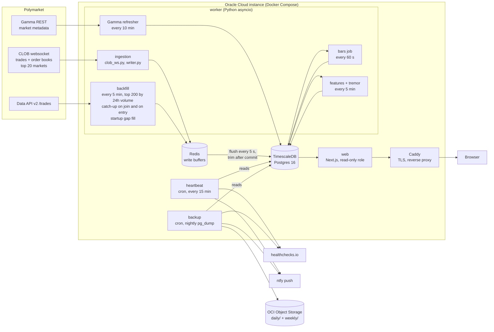

# Zleek Score

Zleek Score watches Polymarket prediction markets and gives each active market a
**tremor score** from 0 to 100 for unusual price activity. It ingests live trades
and order books, builds 1-minute bars, scores every eligible market every 5
minutes, and shows the results on a dashboard sorted by score.

Live at [zleekin.com](https://zleekin.com). Portfolio project; v1 is two pages: the
markets dashboard and a market detail page.

<!-- DEMO VIDEO: replace with a link or embed, e.g.
[](https://<video-url>)
-->
> **Demo video:** _placeholder, to be added._

<!-- SCREENSHOTS: add files under docs/media/ and replace the placeholders below. -->
| Dashboard | Market detail |
|---|---|
| _screenshot placeholder: `docs/media/dashboard.png`_ | _screenshot placeholder: `docs/media/market-detail.png`_ |

## Contents

- [What the score means](#what-the-score-means)
- [Architecture](#architecture)
- [Data flow](#data-flow)
- [Deployment](#deployment)
- [Monitoring and backups](#monitoring-and-backups)
- [Running locally](#running-locally)
- [Tests](#tests)
- [Engineering notes](#engineering-notes)
- [Repository layout](#repository-layout)
- [Known limitations](#known-limitations)

## What the score means

The tremor score measures how far a market's latest price sits from its own
recent behaviour:

- Take up to the 20 newest 1-minute closes from the last 4 hours
  (`apps/worker/signals/features.py`). With fewer than 10 bars the market is
  quiet and scores 0.
- Compute the z-score of the latest close against those bars.
- Score = `min(|z| / 3, 1) * 100` (`apps/worker/signals/tremor.py`). A move of 3
  standard deviations or more, up or down, scores 100.

Only eligible markets are scored: open, with bars, and either refreshed from
Gamma in the last 2 hours or traded in the last 24 hours. Ended or stale markets
drop off the dashboard.

Order-book imbalance is computed and shown on the detail page when the book is
under 15 minutes old and has both sides, but it is not part of the score yet:
books only exist for the markets the websocket follows (ROADMAP phase 4, step 6).

All prices are stored in YES terms. Trades and books on the NO token are
converted (`1 - p`, bids and asks swapped).

## Architecture



Everything runs as one Docker Compose stack (`docker-compose.prod.yml`): `db`,
`redis`, `worker`, `web` and `caddy`, plus a `heartbeat` service that only runs as
a one-off container from host cron. Only Caddy publishes ports (80 and 443);
Postgres and Redis are reachable only on the internal Docker network.

| Component | Stack | Role |
|---|---|---|
| `apps/worker` | Python 3.11, asyncio, asyncpg, websockets, httpx, pandas | Ingestion, backfill, bars, features, scoring |
| Redis | Redis 7 | Write buffers between ingestion and Postgres |
| Postgres | TimescaleDB 2.31.0 on Postgres 16 | Trades, books, bars (hypertable), features (hypertable), scores |
| `apps/web` | Next.js 16, React 19, `postgres` client, Chart.js | Dashboard and market detail, server-rendered, polling refresh |
| Caddy | Caddy 2 | HTTPS with automatic certificates, reverse proxy to `web:3000` |

## Data flow

1. **Market metadata.** The Gamma refresher fetches open markets every 10
   minutes and upserts them into `markets`, including the YES and NO token ids.
2. **Live trades and books.** The websocket subscribes to the top 20 markets by
   24-hour volume and rechecks the selection every 5 minutes. Each trade and book
   event is converted to YES terms and pushed onto a Redis list.
3. **Backfill.** Every 5 minutes the worker pages Data API v2 `/trades` back one
   hour for the next 200 markets by 24-hour volume (condition ids in batches of
   20, newest-first cursor paging). Three catch-up paths cover trades from before
   a market was followed:
   - on join: when the websocket subscribes to a new market, its last hour is
     fetched about 2 minutes later (the Data API lags ~1-2 minutes);
   - on entry: a market new to the backfill set is fetched over 24 hours once;
   - on startup: the worker backfills from the newest stored trade (up to 48
     hours) and rebuilds bars for the gap.
   Trades are deduplicated on `tx_hash`, and a re-fetched trade is only
   rewritten when its price changed.
4. **Flush to Postgres.** Every 5 seconds the writer reads the Redis buffers,
   inserts into `trades` and `ob_snapshots`, and trims Redis only after the
   transaction commits. Rows that fail with a data error go to a dead-letter
   list instead of blocking the queue.
5. **Bars.** Every 60 seconds the bars job builds `bars_1m` (open, high, low,
   close, volume) from new trades.
6. **Features and score.** Every 5 minutes the features job writes `features_5m`
   (price z-score, order-book imbalance), and the tremor job writes
   `signals_history` and upserts `signals_latest`.
7. **Dashboard.** The web app reads `signals_latest`, `markets`, `bars_1m`,
   `trades` and `features_5m` as the read-only `zleek_web` role and refreshes by
   polling while the tab is visible.

## Deployment

Production runs on a single Oracle Cloud instance at
[zleekin.com](https://zleekin.com), cut over from a Mac launchd setup on
2026-11-03 after a 48-hour parallel run (`docs/parallel-run.md`).

- **Compose stack:** `docker-compose.prod.yml`. Images for `worker` and `web` are
  built on the server. The TimescaleDB image is pinned (`2.31.0-pg16`) because
  restores need the same TimescaleDB version.
- **TLS:** Caddy (`Caddyfile`) gets and renews certificates from Let's Encrypt.
  Ports 80 and 443 have to be open both in the VCN Security List and in `ufw`
  on the instance.
- **Least privilege:** the web app and heartbeat connect as `zleek_web`, which
  has SELECT only and read-only transactions by default. Off-site backup
  credentials can create and read objects but not delete or overwrite them.
- **Secrets:** server-only env files (`apps/worker/ingestion/.env.prod`,
  `apps/web/.env.prod`, `apps/worker/.env.heartbeat`), all gitignored.
  Passwords are hex-only (`openssl rand -hex 32`), since base64 characters break
  connection URLs.
- **Logs:** every service logs to Docker's `json-file` driver, capped at 3 x 10
  MB.
- **Data fixes** follow a fixed order: restart the worker with the code fix,
  then run the repair script, then rebuild derived tables. Repair scripts are
  idempotent and recompute from the stored raw source data, never from current
  values.

## Monitoring and backups

**Heartbeat** (`apps/worker/scripts/heartbeat.py`), run by host cron every 15
minutes in a one-off container. It fails when:

- the newest score is older than 15 minutes;
- the newest live websocket trade is older than 15 minutes;
- no backfilled trade has been stored in the last 2 hours.

Each run pings **healthchecks.io** (`/fail` on failure), which also alerts when no
ping arrives at all (server down, cron stopped). Failures are pushed to a phone
through **ntfy**. Tests: `apps/worker/tests/test_heartbeat.py`.

**Nightly backups** (`infra/backup/zleek-db-backup.sh`, cron 03:20 UTC):

- `pg_dump -Fc` inside the db container, checked with `pg_restore --list`
  before it is kept. 3 dumps kept on local disk.
- Copied off-site to Oracle Object Storage with rclone as one PUT per dump
  (`daily/`, plus Sunday dumps in `weekly/`). Bucket lifecycle rules keep daily
  copies 7 days and weekly copies 35 days.
- A local dump is deleted only once the bucket holds it at the same size.
- A run counts as OK only if the dump is valid, it reached off-site and the
  healthcheck URL is set. Anything else pings `/fail`, pushes to ntfy and exits
  1. Warnings are pushed when a dump nears the 5 GiB single-PUT limit or the
  bucket nears its 20 GB free tier.
- Restore test: `infra/backup/zleek-restore-test.sh` restores into a throwaway
  container with no network and runs the acceptance queries against the copy.

**Other jobs on the server:** a disk alert at 75% and 90%
(`infra/ops/zleek-disk-alert.sh`) and Docker build-cache pruning
(`infra/ops/zleek-docker-prune.sh`).

## Running locally

Prerequisites: Docker, Python 3.11+ (the pinned pandas and numpy need it),
Node.js 20+.

**1. Postgres and Redis**

Create a repo-root `.env` (gitignored) with a hex-only password, then start the
containers:

```sh
echo "POSTGRES_PASSWORD=$(openssl rand -hex 32)" > .env
docker compose up -d
docker compose ps
```

This starts `zleek_db` (Postgres on `127.0.0.1:5435`) and `zleek_redis` (Redis on
`6379`) and applies `infra/sql/schema.sql` and
`infra/sql/migrations/domain_model.sql` on first start only. To re-apply the
schema, `docker compose down && rm -rf postgres_data && docker compose up -d`
(this wipes local data).

**2. Worker**

The worker reads `apps/worker/ingestion/.env.local` (gitignored):

```sh
DATABASE_URL=postgresql://postgres:<POSTGRES_PASSWORD>@localhost:5435/postgres
REDIS_URL=redis://localhost:6379
```

```sh
cd apps/worker
python3.11 -m venv .venv
.venv/bin/pip install -r requirements.txt
cd ingestion
../.venv/bin/python main.py
```

No Polymarket credentials are needed; all endpoints used are public. Within a few
minutes the worker has subscribed to the top 20 markets, and scores appear
after about 10 one-minute bars.

**3. Web app**

The web app reads `apps/web/.env.local` (gitignored). Locally you can use the
`postgres` user, or create the read-only `zleek_web` role as in
`docs/parallel-run.md` section 6 and use the URL from `.env.example`.

```sh
cd apps/web
echo "DATABASE_URL=postgresql://postgres:<POSTGRES_PASSWORD>@localhost:5435/postgres" > .env.local
npm install
npm run dev
```

Open http://localhost:3000.

**Useful checks**

```sh
docker exec zleek_db psql -U postgres -c "SELECT count(*) FROM trades;"
docker exec zleek_db psql -U postgres -c \
  "SELECT market_id, tremor_score, ts FROM signals_latest ORDER BY tremor_score DESC LIMIT 10;"
```

Stop everything with Ctrl-C in the worker and web terminals, then
`docker compose down` (add `-v` to also delete volumes).

## Tests

Worker tests are plain Python scripts, mostly against in-memory fakes and
recorded API pages:

```sh
cd apps/worker
for t in tests/test_*.py; do .venv/bin/python "$t" || echo "FAILED: $t"; done
```

`test_gap_backfill.py` has a live part that calls the Data API and needs a
database with trades in the last 3 hours.

Web tests: `cd apps/web && npm test`.

Data checks live as SQL acceptance queries in `apps/worker/scripts/`, for example
`acceptance_price_orientation.sql` (token labels, YES-terms prices, crossed
books) and `storage-report.sql`.

## Engineering notes

Real problems found and fixed while building and running this. Full write-ups are
in `ROADMAP.md`, `docs/parallel-run.md` and `infra/TODO.md`.

### 1. YES/NO orientation bug (2026-10-30)

**Problem.** Gamma's `clobTokenIds` list outcome 0 ("Yes") first, but the worker
stored index 0 as the NO token. All 58,449 markets had their token labels
reversed. Trades were also stored at each token's own price, so YES trades (p)
and NO trades (1 - p) shared a market's bars and the close zigzagged between
them. The NO-book flip hit the wrong token and swapped sides without converting
prices.

**Measured before the fix:** 107,152 of 260,889 trade prices and 109,344 sides
wrong; 15.0% of bars jumping by more than 0.5; 16,915 of 19,477 order-book
snapshots from the last 24 hours crossed.

**Fix.** Corrected the label mapping and converted every trade and book to YES
terms at ingestion. Repaired the token columns and trade prices from the stored
raw payloads, then rebuilt bars, features and scores. Order-book snapshots have
no raw column, so they couldn't be recomputed; they have a documented cutoff
instead (the first websocket subscribe after the repair, since the websocket
only loads the token mapping when it connects). Acceptance queries A-E
(`apps/worker/scripts/acceptance_price_orientation.sql`) all pass on production.

### 2. Data API v1 retirement and 314,969 recovered trades (2026-11-06)

**Problem.** Polymarket retired Data API v1 on 2026-11-02, the day production cut
over. From 22:27 UTC every backfill request returned HTTP 410. Nothing alerted:
the websocket kept live trades fresh, so the heartbeat stayed green, and the
parallel run compared Mac and production, which ran the same code and were
equally empty.

**Fix.** Moved the backfill to `/v2/trades` (condition batches of 20, cursor
paging, snake_case fields, `Retry-After` on 429/503). Added an absolute heartbeat
check: FAIL when no backfilled trade has been stored in 2 hours. A run where every
request fails is logged at ERROR with a count of failed runs in a row.

**Recovery.** A one-off script (`apps/worker/scripts/recover_backfill_gap_2026-11.py`,
dry run by default) re-fetched 2026-11-02 22:20 to 2026-11-06 16:05 UTC after a
verified backup. It inserted **314,969 trades**, matched day by day against the
database, and bars were rebuilt for the window. The estimate had been ~20,000;
the difference led to the next finding.

**Lesson:** relative comparisons need absolute checks alongside them.

### 3. Onset loss (2026-11-07 to 2026-11-14)

**Problem.** Most of the recovered trades had not been lost to the v1 outage but
before a market was followed at all. Busy markets traded hundreds of trades
before entering the websocket's top 20, the liquidity-ranked backfill never
picked them up, and joining the websocket did not fetch earlier trades.

**Method.** Each UTC day is measured on a fixed set of markets ranked by that
day's own USD volume (top 20, then the next 200), saved to a file so later runs
measure the same markets. Missing share = Data API trades not in the database.

**Fixes**, deployed and measured one at a time:
- Step 2: rank the backfill by 24-hour volume among recently refreshed open
  markets, instead of by liquidity.
- Step 3: catch up on join, fetching a market's last hour when the websocket
  subscribes to it.
- Step 2c: catch up on entry, fetching 24 hours for a market new to the backfill
  set (deployed 2026-11-14; measurement pending).

| Day | Worker | Top 20 missing | Next 200 missing | Onset loss, all |
|---|---|---|---|---|
| 2026-11-07 | baseline | 30.5% | 80.3% | 62.8% |
| 2026-11-09 | step 2 | 7.6% | 11.0% | 7.8% |
| 2026-11-12 | steps 2 + 3 | **0.4%** | 8.9% | 5.8% |

For the websocket's markets, onset loss fell from 30.5% to 0.4% (288 of 64,339
trades). Across all 220 measured markets it fell from 62.8% to 5.8%; step 2c
targets most of what remains, in the next 200.

### 4. Off-site backups failing silently (2026-11-09 to 2026-11-16)

**Problem.** Once nightly dumps passed 200 MB, rclone switched to multipart
upload, which the bucket policy refuses (OCI reports it as `NoSuchBucket`). Every
off-site copy failed from 2026-11-09. The script logged FAIL and exited 1 each
night, but the healthcheck URL was optional and had never been set, so nothing
alerted. Local retention also ran before the copy, so the 2026-11-09 dump was
deleted while off-site lacked it; that night has no copy (later dumps cover its
data).

**Fix.** Re-uploaded 10-16 Nov as single-request uploads and verified them with
`rclone check` (0 differences). In the script: single-PUT upload flags on the
copy itself, retention only after a successful copy and only for dumps the bucket
holds at the same size, the healthcheck URL required (a run without one fails),
an ntfy push on every failure, and warnings before the 5 GiB single-PUT limit
and the 20 GB free tier.

**Lesson:** an alert that is optional is an alert that is off.

## Repository layout

```
apps/worker/ingestion/   websocket, Data API backfill, Gamma client, Redis writer, bars job
apps/worker/signals/     features (z-score, imbalance) and tremor score
apps/worker/scripts/     heartbeat, acceptance queries, repair and recovery scripts
apps/worker/tests/       worker tests
apps/web/                Next.js dashboard and market detail page
infra/sql/               schema and migrations
infra/backup/            nightly backup and restore test
infra/ops/               disk alert, Docker prune, ntfy helper
infra/mac/               Mac jobs (nightly trades_archive rehearsal)
docs/                    parallel run and cutover, storage plan, trades_archive design
ROADMAP.md               phases, measurements and decisions
infra/TODO.md            backlog with file references
```

## Known limitations

- The websocket follows 20 markets, so only those have order books and
  imbalance. Raising the cap is ROADMAP phase 4, step 5.
- Gamma's offset pagination stops at about 2,100 markets (HTTP 422 beyond that).
- One fill per transaction: `trades.tx_hash` is unique, so a transaction with
  several fills keeps only the first fill's size. Observed 0 times so far;
  monitored by `apps/worker/scripts/check_multifill_collisions.py`.
- Very quiet or near-frozen markets can score high on tiny ticks, since the
  z-score divides by the market's own standard deviation. A scoring floor is an
  open product decision.
- Storage: TimescaleDB compression and a compressed `trades_archive` are in
  progress (`docs/trades-archive-design.md`).
